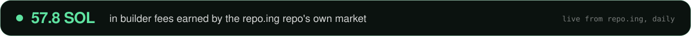
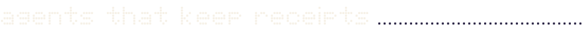
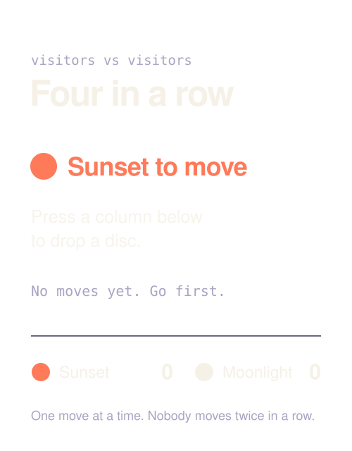

<a href="https://repo.ing"><picture><source media="(prefers-color-scheme: dark)" srcset="assets/sky-dark.svg"><source media="(prefers-color-scheme: light)" srcset="assets/sky-light.svg"></picture></a>

<a href="https://github.com/New1Direction/korg" title="korg"><picture><source media="(prefers-color-scheme: dark)" srcset="assets/tower-korg-dark.svg"><source media="(prefers-color-scheme: light)" srcset="assets/tower-korg-light.svg"></picture></a><a href="https://github.com/New1Direction/OntologyEX" title="OntologyEX"><picture><source media="(prefers-color-scheme: dark)" srcset="assets/tower-ontologyex-dark.svg"><source media="(prefers-color-scheme: light)" srcset="assets/tower-ontologyex-light.svg"></picture></a><a href="https://github.com/New1Direction/ningen-shikkaku" title="ningen-shikkaku"><picture><source media="(prefers-color-scheme: dark)" srcset="assets/tower-ningen-shikkaku-dark.svg"><source media="(prefers-color-scheme: light)" srcset="assets/tower-ningen-shikkaku-light.svg"></picture></a><a href="https://github.com/New1Direction/korgex" title="korgex"><picture><source media="(prefers-color-scheme: dark)" srcset="assets/tower-korgex-dark.svg"><source media="(prefers-color-scheme: light)" srcset="assets/tower-korgex-light.svg"></picture></a><a href="https://repo.ing" title="repo.ing"><picture><source media="(prefers-color-scheme: dark)" srcset="assets/tower-repo-ing-dark.svg"><source media="(prefers-color-scheme: light)" srcset="assets/tower-repo-ing-light.svg"></picture></a><a href="https://ohiyo.gg" title="ohiyo"><picture><source media="(prefers-color-scheme: dark)" srcset="assets/tower-ohiyo-dark.svg"><source media="(prefers-color-scheme: light)" srcset="assets/tower-ohiyo-light.svg"></picture></a><a href="https://github.com/New1Direction/webmcp-anything" title="webmcp-anything"><picture><source media="(prefers-color-scheme: dark)" srcset="assets/tower-webmcp-anything-dark.svg"><source media="(prefers-color-scheme: light)" srcset="assets/tower-webmcp-anything-light.svg"></picture></a><a href="https://github.com/New1Direction/RepoLens" title="RepoLens"><picture><source media="(prefers-color-scheme: dark)" srcset="assets/tower-repolens-dark.svg"><source media="(prefers-color-scheme: light)" srcset="assets/tower-repolens-light.svg"></picture></a><a href="https://github.com/New1Direction/okto" title="okto"><picture><source media="(prefers-color-scheme: dark)" srcset="assets/tower-okto-dark.svg"><source media="(prefers-color-scheme: light)" srcset="assets/tower-okto-light.svg"></picture></a><a href="https://github.com/New1Direction/thumper" title="thumper"><picture><source media="(prefers-color-scheme: dark)" srcset="assets/tower-thumper-dark.svg"><source media="(prefers-color-scheme: light)" srcset="assets/tower-thumper-light.svg"></picture></a> <picture><source media="(prefers-color-scheme: dark)" srcset="assets/street-dark.svg"><source media="(prefers-color-scheme: light)" srcset="assets/street-light.svg"></picture> <a href="https://github.com/New1Direction/New1Direction/issues/new?title=vote+for+korg&body=Press+the+green+button+below+to+cast+your+vote.+The+tower+with+the+most+votes+grows+a+rooftop+garden." title="Vote for korg"><picture><source media="(prefers-color-scheme: dark)" srcset="assets/vote-korg-dark.svg"><source media="(prefers-color-scheme: light)" srcset="assets/vote-korg-light.svg"></picture></a><a href="https://github.com/New1Direction/New1Direction/issues/new?title=vote+for+OntologyEX&body=Press+the+green+button+below+to+cast+your+vote.+The+tower+with+the+most+votes+grows+a+rooftop+garden." title="Vote for OntologyEX"><picture><source media="(prefers-color-scheme: dark)" srcset="assets/vote-ontologyex-dark.svg"><source media="(prefers-color-scheme: light)" srcset="assets/vote-ontologyex-light.svg"></picture></a><a href="https://github.com/New1Direction/New1Direction/issues/new?title=vote+for+ningen-shikkaku&body=Press+the+green+button+below+to+cast+your+vote.+The+tower+with+the+most+votes+grows+a+rooftop+garden." title="Vote for ningen-shikkaku"><picture><source media="(prefers-color-scheme: dark)" srcset="assets/vote-ningen-shikkaku-dark.svg"><source media="(prefers-color-scheme: light)" srcset="assets/vote-ningen-shikkaku-light.svg"></picture></a><a href="https://github.com/New1Direction/New1Direction/issues/new?title=vote+for+korgex&body=Press+the+green+button+below+to+cast+your+vote.+The+tower+with+the+most+votes+grows+a+rooftop+garden." title="Vote for korgex"><picture><source media="(prefers-color-scheme: dark)" srcset="assets/vote-korgex-dark.svg"><source media="(prefers-color-scheme: light)" srcset="assets/vote-korgex-light.svg"></picture></a><a href="https://github.com/New1Direction/New1Direction/issues/new?title=vote+for+repo.ing&body=Press+the+green+button+below+to+cast+your+vote.+The+tower+with+the+most+votes+grows+a+rooftop+garden." title="Vote for repo.ing"><picture><source media="(prefers-color-scheme: dark)" srcset="assets/vote-repo-ing-dark.svg"><source media="(prefers-color-scheme: light)" srcset="assets/vote-repo-ing-light.svg"></picture></a><a href="https://github.com/New1Direction/New1Direction/issues/new?title=vote+for+ohiyo&body=Press+the+green+button+below+to+cast+your+vote.+The+tower+with+the+most+votes+grows+a+rooftop+garden." title="Vote for ohiyo"><picture><source media="(prefers-color-scheme: dark)" srcset="assets/vote-ohiyo-dark.svg"><source media="(prefers-color-scheme: light)" srcset="assets/vote-ohiyo-light.svg"></picture></a><a href="https://github.com/New1Direction/New1Direction/issues/new?title=vote+for+webmcp-anything&body=Press+the+green+button+below+to+cast+your+vote.+The+tower+with+the+most+votes+grows+a+rooftop+garden." title="Vote for webmcp-anything"><picture><source media="(prefers-color-scheme: dark)" srcset="assets/vote-webmcp-anything-dark.svg"><source media="(prefers-color-scheme: light)" srcset="assets/vote-webmcp-anything-light.svg"></picture></a><a href="https://github.com/New1Direction/New1Direction/issues/new?title=vote+for+RepoLens&body=Press+the+green+button+below+to+cast+your+vote.+The+tower+with+the+most+votes+grows+a+rooftop+garden." title="Vote for RepoLens"><picture><source media="(prefers-color-scheme: dark)" srcset="assets/vote-repolens-dark.svg"><source media="(prefers-color-scheme: light)" srcset="assets/vote-repolens-light.svg"></picture></a><a href="https://github.com/New1Direction/New1Direction/issues/new?title=vote+for+okto&body=Press+the+green+button+below+to+cast+your+vote.+The+tower+with+the+most+votes+grows+a+rooftop+garden." title="Vote for okto"><picture><source media="(prefers-color-scheme: dark)" srcset="assets/vote-okto-dark.svg"><source media="(prefers-color-scheme: light)" srcset="assets/vote-okto-light.svg"></picture></a><a href="https://github.com/New1Direction/New1Direction/issues/new?title=vote+for+thumper&body=Press+the+green+button+below+to+cast+your+vote.+The+tower+with+the+most+votes+grows+a+rooftop+garden." title="Vote for thumper"><picture><source media="(prefers-color-scheme: dark)" srcset="assets/vote-thumper-dark.svg"><source media="(prefers-color-scheme: light)" srcset="assets/vote-thumper-light.svg"></picture></a>

<a href="https://github.com/New1Direction/New1Direction/issues/new?title=light+a+window&body=Press+the+green+button+below+and+a+window+in+the+city+lights+up+with+your+name+on+it."><picture><source media="(prefers-color-scheme: dark)" srcset="assets/ticker-dark.svg"><source media="(prefers-color-scheme: light)" srcset="assets/ticker-light.svg"></picture></a>

  <b>This city is alive.</b> Each tower is one of my repos, sized by its stars and redrawn every day. 
  Click a tower to visit it, press a leaf to vote for the tower that gets a <b>rooftop garden</b>, 
  or <a href="https://github.com/New1Direction/New1Direction/issues/new?title=light+a+window&body=Press+the+green+button+below+and+a+window+in+the+city+lights+up+with+your+name+on+it."><b>light a window</b></a> and your name joins the skyline.

  I'm <b>ares</b>, a self-taught engineer. I build markets that pay open source builders, 
  a group chat you can run yourself, and tools that make AI agents provable and safe to run.

  <a href="https://repo.ing"><b>repo.ing</b></a> &nbsp;·&nbsp;
  <a href="https://ohiyo.gg"><b>ohiyo.gg</b></a> &nbsp;·&nbsp;
  <a href="https://x.com/repodoting">@repodoting on X</a> &nbsp;·&nbsp;
  <a href="https://x.com/AresAgent">@AresAgent</a>

<picture><source media="(prefers-color-scheme: dark)" srcset="assets/feed-dark.svg"><source media="(prefers-color-scheme: light)" srcset="assets/feed-light.svg"></picture>

<picture><source media="(prefers-color-scheme: dark)" srcset="assets/heading-building-dark.svg"><source media="(prefers-color-scheme: light)" srcset="assets/heading-building-light.svg"></picture>

  <a href="https://repo.ing/explore"><b>Explore markets</b></a> &nbsp;·&nbsp;
  <a href="https://repo.ing/launch">Launch a repo</a> &nbsp;·&nbsp;
  <a href="https://repo.ing/stats">Protocol analytics</a> &nbsp;·&nbsp;
  <a href="https://github.com/New1Direction/repo.ing">Source</a>

  <a href="https://app.ohiyo.gg"><b>Open Ohiyo</b></a> &nbsp;·&nbsp;
  <a href="https://ohiyo.gg">Visit the site</a> &nbsp;·&nbsp;
  <a href="https://github.com/New1Direction/ohiyo">Host it yourself</a>

<picture><source media="(prefers-color-scheme: dark)" srcset="assets/heading-agents-dark.svg"><source media="(prefers-color-scheme: light)" srcset="assets/heading-agents-light.svg"></picture>

Tools for AI agents you can check, rewind and trust with secrets.

  
  
  
  

<picture><source media="(prefers-color-scheme: dark)" srcset="assets/heading-more-dark.svg"><source media="(prefers-color-scheme: light)" srcset="assets/heading-more-light.svg"></picture>

  
  
  
  

<picture><source media="(prefers-color-scheme: dark)" srcset="assets/heading-play-dark.svg"><source media="(prefers-color-scheme: light)" srcset="assets/heading-play-light.svg"></picture>

<picture><source media="(prefers-color-scheme: dark)" srcset="assets/game-board-dark.svg"><source media="(prefers-color-scheme: light)" srcset="assets/game-board-light.svg"></picture><picture><source media="(prefers-color-scheme: dark)" srcset="assets/game-panel-dark.svg"><source media="(prefers-color-scheme: light)" srcset="assets/game-panel-light.svg"></picture> <a href="https://github.com/New1Direction/New1Direction/issues/new?title=drop+1&body=Press+the+green+button+below+to+drop+your+disc.+Nobody+can+move+twice+in+a+row." title="Drop a disc in column 1"><picture><source media="(prefers-color-scheme: dark)" srcset="assets/game-drop-1-dark.svg"><source media="(prefers-color-scheme: light)" srcset="assets/game-drop-1-light.svg"></picture></a><a href="https://github.com/New1Direction/New1Direction/issues/new?title=drop+2&body=Press+the+green+button+below+to+drop+your+disc.+Nobody+can+move+twice+in+a+row." title="Drop a disc in column 2"><picture><source media="(prefers-color-scheme: dark)" srcset="assets/game-drop-2-dark.svg"><source media="(prefers-color-scheme: light)" srcset="assets/game-drop-2-light.svg"></picture></a><a href="https://github.com/New1Direction/New1Direction/issues/new?title=drop+3&body=Press+the+green+button+below+to+drop+your+disc.+Nobody+can+move+twice+in+a+row." title="Drop a disc in column 3"><picture><source media="(prefers-color-scheme: dark)" srcset="assets/game-drop-3-dark.svg"><source media="(prefers-color-scheme: light)" srcset="assets/game-drop-3-light.svg"></picture></a><a href="https://github.com/New1Direction/New1Direction/issues/new?title=drop+4&body=Press+the+green+button+below+to+drop+your+disc.+Nobody+can+move+twice+in+a+row." title="Drop a disc in column 4"><picture><source media="(prefers-color-scheme: dark)" srcset="assets/game-drop-4-dark.svg"><source media="(prefers-color-scheme: light)" srcset="assets/game-drop-4-light.svg"></picture></a><a href="https://github.com/New1Direction/New1Direction/issues/new?title=drop+5&body=Press+the+green+button+below+to+drop+your+disc.+Nobody+can+move+twice+in+a+row." title="Drop a disc in column 5"><picture><source media="(prefers-color-scheme: dark)" srcset="assets/game-drop-5-dark.svg"><source media="(prefers-color-scheme: light)" srcset="assets/game-drop-5-light.svg"></picture></a><a href="https://github.com/New1Direction/New1Direction/issues/new?title=drop+6&body=Press+the+green+button+below+to+drop+your+disc.+Nobody+can+move+twice+in+a+row." title="Drop a disc in column 6"><picture><source media="(prefers-color-scheme: dark)" srcset="assets/game-drop-6-dark.svg"><source media="(prefers-color-scheme: light)" srcset="assets/game-drop-6-light.svg"></picture></a><a href="https://github.com/New1Direction/New1Direction/issues/new?title=drop+7&body=Press+the+green+button+below+to+drop+your+disc.+Nobody+can+move+twice+in+a+row." title="Drop a disc in column 7"><picture><source media="(prefers-color-scheme: dark)" srcset="assets/game-drop-7-dark.svg"><source media="(prefers-color-scheme: light)" srcset="assets/game-drop-7-light.svg"></picture></a><picture><source media="(prefers-color-scheme: dark)" srcset="assets/game-spacer-dark.svg"><source media="(prefers-color-scheme: light)" srcset="assets/game-spacer-light.svg"></picture>

<picture><source media="(prefers-color-scheme: dark)" srcset="assets/year-dark.svg"><source media="(prefers-color-scheme: light)" srcset="assets/year-light.svg"></picture>

<b>How this page works</b>

 

No JavaScript runs here. GitHub doesn't allow it, so everything is a picture that happens to be alive.

- **The city is data.** A GitHub Action reads each repo's stars once a day and redraws its tower. More stars, more floors. A blinking beacon means the repo changed this month.
- **Every tower is its own picture**, placed edge to edge, which is why you can click them one by one.
- **The motion is CSS inside SVG.** The headline, the shooting stars and the flickering windows are drawn once and animate on their own. If your device asks for less motion, they hold still.
- **The year view is my contribution graph in 3D.** Each day of the last year is a building, taller on busier days. It rises in a wave when the page loads and is redrawn daily.
- **The product shots are real.** The repo.ing and Ohiyo screens are actual screenshots, stored inside each picture and framed in a drawn browser window and phone.
- **Night and day follow your theme.** Switch GitHub between dark and light and the city goes from night to dawn.
- **Lighting a window opens an issue.** An Action reads only your username, adds a lit window and your avatar to the ticker, redraws the city and closes the issue, usually within a minute.
- **The leaves are a vote.** Each one opens an issue too. One vote per person, and the tower in the lead grows a rooftop garden.
- **The game is real.** Four in a row, visitors against visitors. Each arrow opens an issue; an Action checks the move, drops the disc and keeps score. Nobody can move twice in a row.
- **The moon is tonight's moon.** Its phase is worked out from the date. The traffic and the airship are just for fun.
- **"Recently shipped" is real too.** It shows the newest commit on each project, read daily.
- **The weather is the real season.** Snow in winter, petals in spring, fireflies in summer, falling leaves in autumn, and fireworks on New Year's Day and my GitHub anniversary.
- **The project cards update too.** Their star counts are read daily, and the repo.ing fee figure comes from repo.ing's own public badge.

The code is in [`scripts/`](scripts) if you want to build your own.

Your open source work can earn. Tokenize a repo at <a href="https://repo.ing">repo.ing</a>.

