<a href="https://repo.ing"><picture><source media="(prefers-color-scheme: dark)" srcset="assets/sky-dark.svg"><source media="(prefers-color-scheme: light)" srcset="assets/sky-light.svg"></picture></a>

<a href="https://github.com/New1Direction/korg" title="korg"><picture><source media="(prefers-color-scheme: dark)" srcset="assets/tower-korg-dark.svg"><source media="(prefers-color-scheme: light)" srcset="assets/tower-korg-light.svg">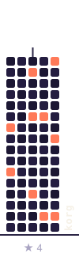</picture></a><a href="https://github.com/New1Direction/OntologyEX" title="OntologyEX"><picture><source media="(prefers-color-scheme: dark)" srcset="assets/tower-ontologyex-dark.svg"><source media="(prefers-color-scheme: light)" srcset="assets/tower-ontologyex-light.svg">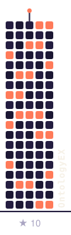</picture></a><a href="https://github.com/New1Direction/ningen-shikkaku" title="ningen-shikkaku"><picture><source media="(prefers-color-scheme: dark)" srcset="assets/tower-ningen-shikkaku-dark.svg"><source media="(prefers-color-scheme: light)" srcset="assets/tower-ningen-shikkaku-light.svg">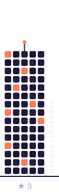</picture></a><a href="https://github.com/New1Direction/korgex" title="korgex"><picture><source media="(prefers-color-scheme: dark)" srcset="assets/tower-korgex-dark.svg"><source media="(prefers-color-scheme: light)" srcset="assets/tower-korgex-light.svg">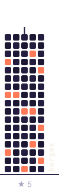</picture></a><a href="https://repo.ing" title="repo.ing"><picture><source media="(prefers-color-scheme: dark)" srcset="assets/tower-repo-ing-dark.svg"><source media="(prefers-color-scheme: light)" srcset="assets/tower-repo-ing-light.svg">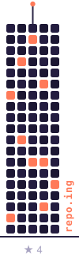</picture></a><a href="https://ohiyo.gg" title="ohiyo"><picture><source media="(prefers-color-scheme: dark)" srcset="assets/tower-ohiyo-dark.svg"><source media="(prefers-color-scheme: light)" srcset="assets/tower-ohiyo-light.svg">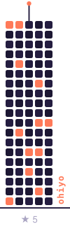</picture></a><a href="https://github.com/New1Direction/webmcp-anything" title="webmcp-anything"><picture><source media="(prefers-color-scheme: dark)" srcset="assets/tower-webmcp-anything-dark.svg"><source media="(prefers-color-scheme: light)" srcset="assets/tower-webmcp-anything-light.svg">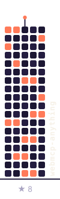</picture></a><a href="https://github.com/New1Direction/RepoLens" title="RepoLens"><picture><source media="(prefers-color-scheme: dark)" srcset="assets/tower-repolens-dark.svg"><source media="(prefers-color-scheme: light)" srcset="assets/tower-repolens-light.svg">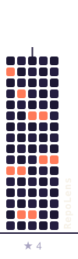</picture></a><a href="https://github.com/New1Direction/okto" title="okto"><picture><source media="(prefers-color-scheme: dark)" srcset="assets/tower-okto-dark.svg"><source media="(prefers-color-scheme: light)" srcset="assets/tower-okto-light.svg">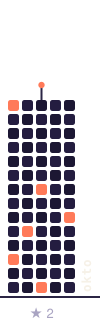</picture></a><a href="https://github.com/New1Direction/thumper" title="thumper"><picture><source media="(prefers-color-scheme: dark)" srcset="assets/tower-thumper-dark.svg"><source media="(prefers-color-scheme: light)" srcset="assets/tower-thumper-light.svg">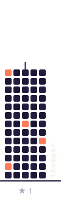</picture></a>

<a href="https://github.com/New1Direction/New1Direction/issues/new?title=light+a+window&body=Press+the+green+button+below+and+a+window+in+the+city+lights+up+with+your+name+on+it."><picture><source media="(prefers-color-scheme: dark)" srcset="assets/ticker-dark.svg"><source media="(prefers-color-scheme: light)" srcset="assets/ticker-light.svg"></picture></a>

  <b>This city is alive.</b> Each tower is one of my repos, sized by its stars and redrawn every day. 
  Click a tower to visit it, or <a href="https://github.com/New1Direction/New1Direction/issues/new?title=light+a+window&body=Press+the+green+button+below+and+a+window+in+the+city+lights+up+with+your+name+on+it."><b>light a window</b></a> and your name joins the skyline.

  I'm <b>ares</b>, a self-taught engineer. I build markets that pay open source builders, 
  a group chat you can run yourself, and tools that make AI agents provable and safe to run.

  <a href="https://repo.ing"><b>repo.ing</b></a> &nbsp;·&nbsp;
  <a href="https://ohiyo.gg"><b>ohiyo.gg</b></a> &nbsp;·&nbsp;
  <a href="https://x.com/repodoting">@repodoting on X</a> &nbsp;·&nbsp;
  <a href="https://x.com/AresAgent">@AresAgent</a>

## What I'm building

  <a href="https://repo.ing"></a>
  <a href="https://github.com/New1Direction/ohiyo"></a>

- **[repo.ing](https://repo.ing)** connects public GitHub repos to their own markets on Solana. Anyone can launch one, and every trade earns fees for the people who built the code. [Explore markets](https://repo.ing/explore) or [read the source](https://github.com/New1Direction/repo.ing).
- **[Ohiyo](https://ohiyo.gg)** is a free, open source group chat with channels, DMs, voice, video and screen share. Use it [in your browser](https://app.ohiyo.gg) or [host it yourself](https://github.com/New1Direction/ohiyo).

## Agents that keep receipts

Tools for AI agents you can check, rewind and trust with secrets.

  <a href="https://github.com/New1Direction/korg">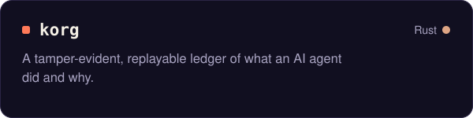</a>
  <a href="https://github.com/New1Direction/korgex">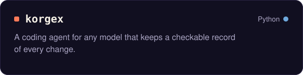</a>
  <a href="https://github.com/New1Direction/ningen-shikkaku">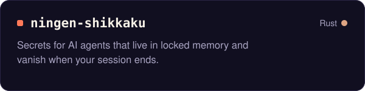</a>
  <a href="https://github.com/New1Direction/thumper">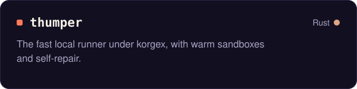</a>

## More things I made

  <a href="https://github.com/New1Direction/OntologyEX">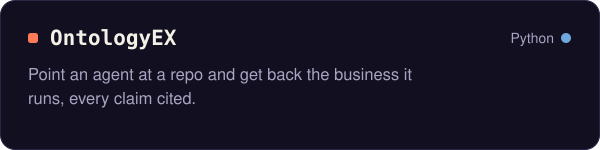</a>
  <a href="https://github.com/New1Direction/webmcp-anything">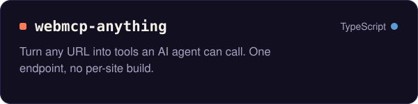</a>
  <a href="https://github.com/New1Direction/RepoLens">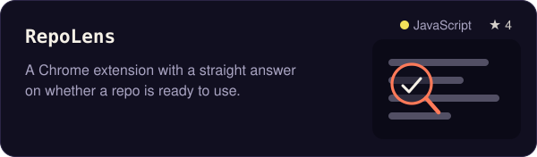</a>
  <a href="https://github.com/New1Direction/okto">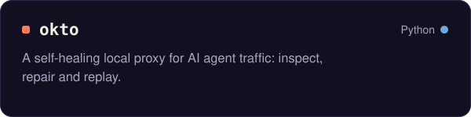</a>

<picture>
  <source media="(prefers-color-scheme: dark)" srcset="https://raw.githubusercontent.com/New1Direction/New1Direction/output/github-contribution-grid-snake-dark.svg">
  <source media="(prefers-color-scheme: light)" srcset="https://raw.githubusercontent.com/New1Direction/New1Direction/output/github-contribution-grid-snake.svg">
  
</picture>

<b>How this page works</b>

 

No JavaScript runs here. GitHub doesn't allow it, so everything is a picture that happens to be alive.

- **The city is data.** A GitHub Action reads each repo's stars once a day and redraws its tower. More stars, more floors. A blinking beacon means the repo changed this month.
- **Every tower is its own picture**, placed edge to edge, which is why you can click them one by one.
- **The motion is CSS inside SVG.** The headline, the shooting stars and the flickering windows are drawn once and animate on their own. If your device asks for less motion, they hold still.
- **Night and day follow your theme.** Switch GitHub between dark and light and the city goes from night to dawn.
- **Lighting a window opens an issue.** An Action reads only your username, adds a lit window, redraws the city and closes the issue, usually within a minute.

The code is in [`scripts/`](scripts) if you want to build your own.

Your open source work can earn. Tokenize a repo at <a href="https://repo.ing">repo.ing</a>.

